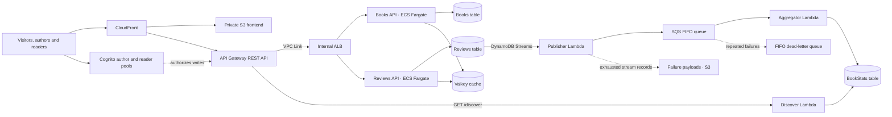

# Book Review Platform

A book discovery application built with React, Python and AWS. Authors add book metadata, readers leave ratings and optional reviews, and a public Discover page ranks books by their average rating. Terraform describes the infrastructure in reusable modules, with separate staging and production configurations.

The application combines containerized APIs with an event-driven serverless workflow: a review is stored once, published as an event, and reflected in a separately maintained ranking.

## What the application does

- **Authors** sign up through an author account and add a book's title, author name and description. Books are metadata only; there are no cover images or book-file uploads.
- **Readers** sign up through a separate reader account and submit one review per book, with a rating from 1 to 5 and optional text. Books and reviews cannot be edited or deleted.
- **Visitors** can browse books and reviews and see the ten highest-rated books on Discover. Reviews are displayed newest first.
- The review feed and Discover ranking are eventually consistent. Discover responses are cached at CloudFront for up to 10 minutes, in addition to event-processing and index propagation time.

## Architecture



The Books and Reviews APIs run as separate ECS Fargate services behind a private Application Load Balancer. The VPC has private subnets in two Availability Zones, and the services use VPC endpoints to reach AWS services without public task IPs. Valkey has a primary and replica across the two AZs; its cached data is non-authoritative and the application falls back to DynamoDB if the cache is unavailable.

CloudFront serves the React app from a private S3 bucket and routes API requests to the regional REST API. Cognito uses separate author and reader user pools. API Gateway validates write requests; the services also check the expected identity claims. Public traffic uses HTTPS; the API Gateway-to-ALB connection uses HTTP inside the private network.

## How review aggregation works

1. The Reviews API writes a review and a reader/book uniqueness marker in one DynamoDB transaction. This prevents the same reader account from submitting two reviews for one book.
2. DynamoDB Streams invokes a publisher Lambda for review inserts. The publisher sends an event to an SQS FIFO queue, using the book ID as the message group and the review ID as the stable event ID.
3. An aggregator Lambda processes the queue and updates the book's rating count, total and average. It writes a persistent event marker and updated statistics in a transaction, so a repeated event does not increment the count twice.
4. The Discover Lambda queries four rating-index shards and merges the results into a top-ten ranking. Ties use a deterministic book-ID order. Event failures are surfaced through an S3 failure destination, a FIFO dead-letter queue and CloudWatch alarms.

Reviews use timestamp-first sort keys across four shards. The API merges the shard results for newest-first pagination. Books and reviews are append-only, which keeps the event model focused on new reviews.

## Terraform structure

```text
infra/
├── environments/
│   ├── staging/               # Staging root and provider configuration
│   └── prod/                  # Production root and provider configuration
└── modules/
    ├── network/               # VPC, subnets, security groups, endpoints
    ├── data/                  # DynamoDB, queues, buckets, Valkey
    ├── identity/              # Cognito user pools and clients
    ├── compute/               # ECS cluster, ALB and service composition
    ├── ecs-service/           # Reusable Books/Reviews service pattern
    ├── functions/             # Lambda functions and event-source mappings
    ├── api/                   # REST API, authorizers and VPC Link
    ├── edge/                  # CloudFront and frontend delivery
    ├── alerts/                # SNS alert topic and encryption
    └── monitoring/            # CloudWatch alarms and dashboard
```

Each module has its own `main.tf`, `variables.tf` and `outputs.tf`. The two environment roots use separate resource names and local state paths. They currently target the **same AWS account**; separate state does not provide account-level isolation. Both VPCs use the diagram's CIDR ranges, so connecting them directly would require an addressing redesign.

The repository also contains:

```text
backend/       Python API services, shared code and Lambda handlers
frontend/      React application
scripts/       Local packaging and guarded Terraform planning
tests/        Backend tests
```

## API at a glance

| Method | Path | Purpose | Access |
| --- | --- | --- | --- |
| `GET` | `/books` | List books with pagination | Public |
| `GET` | `/books/{bookId}` | Read a book | Public |
| `POST` | `/books` | Add immutable book metadata | Author |
| `GET` | `/reviews/{bookId}` | List reviews, newest first | Public |
| `POST` | `/reviews/{bookId}` | Add one immutable review per reader | Reader |
| `GET` | `/discover` | Get the top-rated books | Public |

## Local development

Prerequisites: Python 3.12, Node.js 22 or newer, npm, and Terraform 1.15.x. AWS CLI credentials are needed only for an AWS-backed plan. The following commands use PowerShell on Windows.

### Preview the frontend

```powershell
cd frontend
npm.cmd ci
npm.cmd run dev
```

Open [http://127.0.0.1:5173/?demo=1](http://127.0.0.1:5173/?demo=1) for a **read-only preview using sample data**. Signup and publishing are disabled in preview mode. Without a deployed configuration file, the app shows a setup screen.

### Run tests

From the repository root:

```powershell
python -m venv .venv
.\.venv\Scripts\python.exe -m pip install -e '.[test]'
.\.venv\Scripts\python.exe -m pytest -q -p no:cacheprovider
.\.venv\Scripts\python.exe -m ruff check backend tests
```

Backend tests use mocked AWS services and test identity checks, review uniqueness, pagination, event replay and aggregation. The mock concurrency test is not a substitute for testing DynamoDB under real concurrent load.

From `frontend/`:

```powershell
npm.cmd run build
npm.cmd test
npm.cmd run test:e2e
```

The browser tests use Microsoft Edge as configured in `frontend/playwright.config.ts`.

### Inspect an infrastructure plan

Build the frontend and create local Lambda packages first:

```powershell
cd frontend
npm.cmd ci
npm.cmd run build
cd ..
python scripts/package_lambdas.py
```

Then choose an environment:

```powershell
.\scripts\plan.ps1 -Environment staging
# or
.\scripts\plan.ps1 -Environment prod
```

The planning script checks the AWS identity, initializes and validates the selected root, and saves the plan under `.local/`. The provider and script are currently configured for the `poc-personal` profile, a specific account and `us-west-2`; adapt both deliberately before using another AWS account. Plans and state can contain sensitive information and should not be committed. The current local backend is intended for local work; shared environments need an appropriately secured remote state backend and locking.
